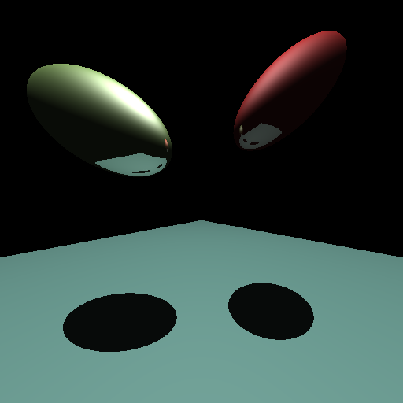

# spookyLights3D

spookyLights3D is a 3D ray tracer written in C. This is the base version of the project, with the main rendering functionality in place. I plan to build on it by adding more geometry and procedural generation features.



## Current functionality

* Planes, spheres, and cylinders, each with its own intersection function.
* Camera and object transformations using 4×4 matrices.
* Phong lighting with ambient, diffuse, and specular components.
* Shadows from point light sources.
* Recursive reflections with a configurable recursion depth.
* Image output in PPM format.

## Compiling

You will need a C11 compiler and the math library. From the project directory, run:

```sh
./compile.sh
```

You can also build the project with CMake:

```sh
cmake -S . -B build
cmake --build build
```

## Running

For example, to render a 512×512 image with a maximum reflection depth of 3, run:

```sh
./spookyLights3D 512 3 render.ppm
```

The arguments specify the image size, the maximum reflection depth, and the output filename, in that order. The output image is always square. Setting the reflection depth to 0 disables recursive reflections.

The scene is defined in `scene.c`, where you can change the objects, their transformations, and the lighting.

If your image viewer does not support PPM files, you can convert the output to PNG using ImageMagick:

```sh
magick render.ppm render.png
```

## Testing

After building with CMake, you can run the intersection tests with:

```sh
ctest --test-dir build --output-on-failure
```

## About this version

I have kept this version focused on the basic renderer. I plan to add additional primitives and procedural geometry separately as the project develops. Maybe some other stuff too, who knows?

## Attribution

This project started from CSC D18 instructional code by F. J. Estrada and includes matrix inversion routines from the original starter code. I have kept the original author credits and attribution details in [ATTRIBUTION.md](ATTRIBUTION.md).

The original code contains a restriction concerning distribution for academic purposes. Permission for unrestricted public distribution has not been established, so let's err on the side of caution and keep this repository for documentation purposes only, okay? 
